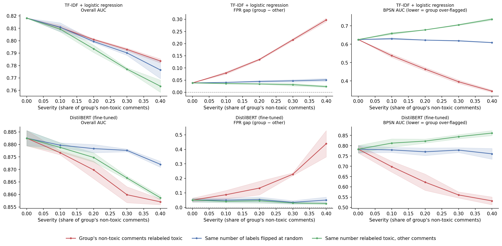

# Which Labels Are Wrong Matters: Group-Targeted Label Noise in Toxicity Classifiers

**Question:** Human annotators sometimes label harmless comments that mention an identity group (e.g., "As a Muslim, I…") as toxic. If a small share of training labels carries this kind of bias, does the classifier inherit it, and would standard accuracy metrics notice?

This project extends my [data-quality stress test](https://github.com/RumeysaGorgulu/data-quality-stress-test) from tabular data to text and fine-tuned transformers. It tests whether the harm comes from *which* labels are wrong, using two control conditions that change the same number of labels.

## Design

- **Data:** [CivilComments-WILDS](https://huggingface.co/datasets/pietrolesci/civilcomments-wilds) (Borkan et al., 2019; Koh et al., 2021). The task is to predict whether a comment is toxic.
- **Group:** comments that mention a Black, Muslim or LGBTQ identity
- **Sample:**
  - 20,000 training comments (30% from the group)
  - 8,000 test comments (50% from the group)
  - The group is over-sampled so that group-level metrics are stable
- **Training labels are corrupted; every model is tested on the same clean test set.**

| Condition | What happens to the training labels |
|---|---|
| **Group-targeted** | A share (= severity) of the group's non-toxic comments are relabeled toxic |
| Control 1: matched random | The **same number** of labels flipped at random rows, in either direction |
| Control 2: matched other | The **same number** of non-toxic comments relabeled toxic, chosen from comments that do **not** mention the group |

Control 2 keeps the number and direction of errors identical, so any difference from the group-targeted condition comes only from *who* the errors fall on.

- **Severity:** 0, 0.1, 0.2, 0.3, 0.4
- **Models:**
  - TF-IDF + logistic regression (baseline)
  - **DistilBERT**, fine-tuned for 1 epoch with a plain PyTorch training loop: AdamW, linear warmup, mixed precision
- **Seeds:** 3
- **Metrics:**
  - Overall AUC and accuracy
  - **FPR gap:** false-positive rate on the group's non-toxic comments minus the rate on other non-toxic comments
  - **BPSN AUC** (Borkan et al., 2019): a fairness metric for this dataset; low values mean the group's non-toxic comments score higher than other toxic comments

## Results

<!-- After the Colab run, paste results/summary.md here and write 2–3 findings -->



**Key findings**
- Relabeling __% of the group's non-toxic comments (__% of all training labels) changed overall AUC by only __ but raised the FPR gap from __ to __ (DistilBERT).
- The same number of random flips changed the FPR gap by __; the same number of errors placed on other comments changed it by __.
- TF-IDF vs. DistilBERT: __

## Run it

**Colab (recommended, free GPU):** open `colab_run.ipynb` in Google Colab, choose a T4 GPU and run all cells. Results are saved to Google Drive, so the run can resume after a disconnect.

**Locally:**
```bash
pip install -r requirements.txt
python prepare_data.py
python run_experiment.py --model tfidf
python run_experiment.py --model transformer     # GPU recommended
python plot_results.py --inp results/tfidf/results.csv results/transformer/results.csv
```

## Limitations

- Synthetic corruption: real annotator bias is not random within the group, and it may depend on dialect or wording (Sap et al., 2019).
- The group is a combination of three identities. Effects may differ for each one; use `--group-cols` to run a single identity.
- One dataset, two model families and a fixed 0.5 decision threshold
- Enriched sample: group shares differ from the natural data, so absolute rates are not population estimates
- 3 seeds give a rough sense of variability, not formal tests.

## Related work

- Borkan, D., Dixon, L., Sorensen, J., Thain, N., & Vasserman, L. (2019). Nuanced metrics for measuring unintended bias with real data for text classification. *WWW Companion.*
- Dixon, L., Li, J., Sorensen, J., Thain, N., & Vasserman, L. (2018). Measuring and mitigating unintended bias in text classification. *AIES.*
- Sap, M., Card, D., Gabriel, S., Choi, Y., & Smith, N. A. (2019). The risk of racial bias in hate speech detection. *ACL.*
- Koh, P. W., et al. (2021). WILDS: A benchmark of in-the-wild distribution shifts. *ICML.*

## License

MIT, see `LICENSE`.
